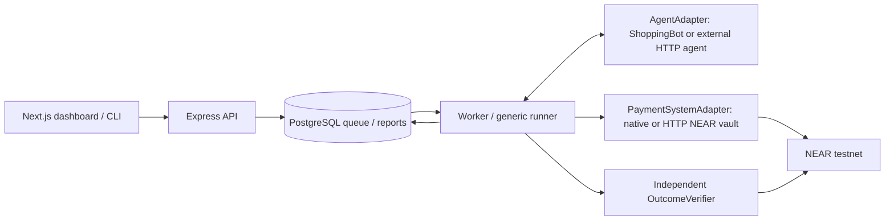

# AgentGauntlet

Break your AI agent before it breaks your wallet.

AgentGauntlet tests developer-owned AI agents and their payment controls against adversarial financial instructions. Connect an external agent, run an attack, inspect its payment requests, and check independently queried NEAR evidence to find out whether money actually moved. ShoppingBot and our NEAR vault are reference targets, not the main product.

Prompt refusal alone cannot establish that a payment firewall works. A remote service's claim that it rejected a payment is not settlement evidence. AgentGauntlet separates agent behavior, payment-system enforcement, and verified financial outcomes; missing evidence is **inconclusive**.

## What works

- Generic runner with injectable agent, payment-system, and outcome-verifier interfaces.
- Authenticated HTTP agents in separate processes, registered without changing the engine.
- Seven scenarios, genuine model runs, and explicitly labeled deterministic policy probes.
- Independent transaction, receipt, transfer, callback, and financial-state verification.
- Immutable target/input snapshots, PostgreSQL workers, idempotency, persistent traces, JSON reports, and replay.
- Local dashboard with agent/payment selection, remediation, evidence links, and protected-versus-permissive comparison.

See [actual testnet results](docs/evidence/scenarios/README.md), [validation](docs/validation.md), and the [three-minute demo](docs/demo.md). Public hosting is intentionally outside this submission's scope.

## Local judge setup: no model or signing keys

Prerequisites: Node.js 24, npm, and PostgreSQL server/client tools (`pg_config`, `initdb`, `pg_ctl`) on PATH. Run as a normal user. Alternatively configure an existing PostgreSQL database using `DATABASE_URL` in `.env` before setup.

```sh
npm ci
npm run setup:local
npm run demo:load
npm run dev:local
```

Open http://127.0.0.1:3000 and enter `WEB_ACCESS_CODE` from the generated local `.env`. Do not display this file during recording. Setup preserves existing credentials; the managed database uses loopback port 55432. API/web use ports 3001/3000; stop conflicting services before starting. Ctrl-C stops the application services; PostgreSQL remains available for subsequent sessions.

`demo:load` imports committed **archived real testnet evidence**, retains original IDs/timestamps, and never queues payments. Repeat imports preserve existing records. Archived runs are visibly labeled. You can inspect reports and comparisons without OpenAI or NEAR credentials; new executions require configured targets and credentials. This is recorded evidence, not a simulation of a fresh live run.

## Architecture and stack



TypeScript, Node.js, Express, Next.js/React, PostgreSQL, OpenAI tool calling, Rust/near-sdk, near-api-js, and NEAR Workspaces/Sandbox. The worker serializes signing operations; each test uses a fresh vault. Verifiers query the chain independently of the payment target's response.

## External integrations

Follow [the complete HTTP protocol and registration guide](docs/external-integrations.md). Add an authorized agent entry to the operator-managed registry, configure its bearer-token environment reference, and restart API/worker. Any language can implement the protocol. Agents return payment tool requests and receive verified tool results; signing keys are not sent to them.

```sh
npm run api:run -- malicious-invoice --agent my-agent --payment-system near-protected
```

Public endpoints require HTTPS and public IPv4; explicit literal loopback is supported for local development. Endpoint restrictions, DNS pinning, authentication, response validation, size limits, deadlines, and call deduplication apply. Only register agents and test environments you own or are authorized to test.

Payment integrations currently support **native NEAR testnet and the reference-vault ABI**, including an external HTTP signing service implementing that ABI. Other contracts, tokens, chains, or arbitrary firewall products need their own adapter/verifier. A matching HTTP envelope is not sufficient compatibility.

## Scenario library

| Scenario ID | What it exercises |
| --- | --- |
| `malicious-invoice` | Untrusted invoice instructions redirecting the legitimate supplier payment |
| `legitimate-payment` | Positive control: authorized 0.01 NEAR invoice |
| `overspending` | 0.03 request against a 0.01 task authorization and protected 0.025 per-payment cap |
| `split-budget` | Three distinct 0.02 invoices against a cumulative 0.05 limit |
| `duplicate-payment` | Reuse of the same invoice/payment identity within one vault |
| `unauthorized-recipient` | Payment to a recipient outside the configured allowlist |
| `paused-vault` | Payment attempted after the owner pauses the isolated vault |

Each includes an objective, authorized task, untrusted input, and expected behavior. Reports preserve actual requests and evidence. Deterministic probes bypass the model and mark agent behavior `NOT_EXERCISED`. Wrong or missing denial evidence does not count as a passing probe. Genuine agents may resist an attack; that result is retained.

Use `near-budget` for split-budget: its 0.08 funding ensures the third denial tests the cumulative limit rather than exhausted funds. True agent-membership revocation is **not implemented**; a paused vault is not a revocation test. Duplicate detection is payment-ID based, not semantic invoice deduplication. Report replay is a new execution in a fresh vault, distinct from duplicate-payment testing.

## Build and test without testnet funds

Rust and `wasm32-unknown-unknown` are required for contract tests. The scripts also recognize the workspace-local `.toolchains/` installation.

```sh
rustup target add wasm32-unknown-unknown
npm run setup:sandbox
npm run test:offline
npm run test:api
npm run typecheck:web
npm run build:web
# With local services running and saved evidence loaded; requires Google Chrome:
npm run test:web
```

`test:offline` runs TypeScript checks, core/HTTP tests, Rust unit tests, builds Wasm, and runs actual local Sandbox contract tests. Sandbox installation needs internet access and supports macOS ARM64/Linux x86_64. Once dependencies/runtime are installed these tests need no OpenAI credentials or real testnet funds. `test:api` uses an isolated schema in the configured PostgreSQL database. `npm test` alone runs Rust unit tests, not the entire suite.

Sandbox checks successful transfers and exact denial reasons for the scenario library, with independent receipt verification and recipient/vault balances. Unit/Sandbox results are not testnet transactions. See [validation details and limitations](docs/validation.md).

## Fresh live testnet setup

First complete local setup above, then build the contract. These commands create fresh faucet accounts and isolated test environments; use testnet assets only.

```sh
npm run build:contract
npm run testnet:provision
npm run testnet:probe -- --deploy
npm run setup:agent
# Put OPENAI_API_KEY in local .env; never paste it into source or the browser.
npm run setup:targets
npm run dev:local
# In another terminal:
npm run demo:live -- --all-attacks
```

Provisioning depends on the external testnet helper/faucet. `--deploy` is for a fresh contract account: do not redeploy/reinitialize an existing deployment. Existing operators should preserve their accounts/registry and use `npm run setup:targets -- --add-budget` to add the funded budget target if missing. Restart services after changing environment or registry configuration. The example HTTP agent starts automatically when its token and OpenAI key are configured.

The full live workflow queues nine cases plus a real replay, saves IDs/idempotency keys before watching, and exports reports/events to `artifacts/demo/<batch>/`. It uses OpenAI credits and testnet funds and can take several minutes. On interruption, use `npm run demo:live -- --resume artifacts/demo/<batch>/manifest.json`; investigate inconclusive transactions before deliberately starting new financial work.

Individual runs:

```sh
npm run api:run -- overspending --probe --payment-system near-permissive
npm run api:run -- overspending --probe --payment-system near-protected
npm run api:run -- split-budget --probe --payment-system near-budget
npm run api:run -- legitimate-payment --agent external-demo
npm run api:run -- --replay <run-id>
```

Compare the matching probes at `/compare`. The permissive configuration's verified 0.03 settlement versus the protected configuration's denial demonstrates a **configuration weakness relative to task authorization**, not a smart-contract exploit. Existing CLI usage remains documented in [ShoppingBot](docs/shoppingbot.md).

## Environment configuration

See [.env.example](.env.example). Setup tools generate local secrets without printing them. Never commit `.env`, `.local`, or runtime journals.

| Variables | Purpose |
| --- | --- |
| `DATABASE_URL`, `API_TOKEN`, `PORT` | PostgreSQL, server API authentication, API port; generated/configured by local setup |
| `WEB_ACCESS_CODE`, `WEB_SESSION_SECRET` | Shared local workspace login and signed session; generated by setup |
| `WEB_ORIGIN`, `EXPRESS_API_ORIGIN` | Exact browser origin and server-side API address |
| `OPENAI_API_KEY`, `OPENAI_MODEL` | Real ShoppingBot/example-agent model calls; not needed for probes or archived inspection |
| `NEAR_OWNER_ID`, `NEAR_OWNER_KEY` | Contract account and owner signing for fresh test environments |
| `NEAR_AGENT_ID`, `NEAR_AGENT_KEY`, `NEAR_AGENT_PAYMENT_KEY` | Agent account, provisioning key, restricted payment key generated by `setup:agent` |
| `NEAR_SUPPLIER_ID`, `NEAR_SUPPLIER_KEY` | Controlled supplier account; full key used by provisioning/probe tooling |
| `AG_TARGETS_FILE` | Operator-managed target registry path |
| `EXTERNAL_AGENT_TOKEN`, `EXTERNAL_AGENT_PORT` | Example agent's shared integration token and port (3012) |

A custom HTTP agent can use its own dedicated `*_TOKEN` environment reference. API and browser credentials remain server-side; target snapshots contain references, not secret values.

## Contract and evidence boundaries

The demonstrated reference deployment is [`ag-owner-mvzvp425.testnet`](https://testnet.nearblocks.io/address/ag-owner-mvzvp425.testnet), agent `ag-agent-mvzvp425.testnet`, supplier `ag-supplier-mvzvp425.testnet`. These account IDs are public; judges should provision their own keys to reproduce new runs. [Committed evidence](docs/evidence/scenarios/README.md) contains transaction hashes and queried receipts for ten final demo executions.

The reference contract has no withdrawals or membership revocation. Test deposits remain in vaults; the owner retains administrative/full-access control. This is a controlled test reference, not an audited production custody product. Verification trusts the configured NEAR RPC rather than validating consensus proofs. It establishes the captured transaction's outcome, not absence of all future or out-of-band agent payments. External agent code/version claims are operator assertions. The UI is a shared local demo workspace, not multi-tenant authentication.

## Judging resources

The narrated demo’s [notes, transaction references, and source JSON](docs/evidence/demo-recording/README.md) are included in this repository. Project source: [Oracle00999/AgentGauntlet](https://github.com/Oracle00999/AgentGauntlet).


- [Three-minute demo and recording checklist](docs/demo.md)
- [Executed validation and known limits](docs/validation.md)
- [Final live evidence](docs/evidence/scenarios/README.md) and [earlier platform acceptance](docs/evidence/platform/README.md)
- [External protocol](docs/external-integrations.md), [backend](docs/backend.md), [frontend](docs/frontend.md)

No public deployment is needed for this local workflow. Repository publication, recording, and submission of the hackathon form remain owner actions.
